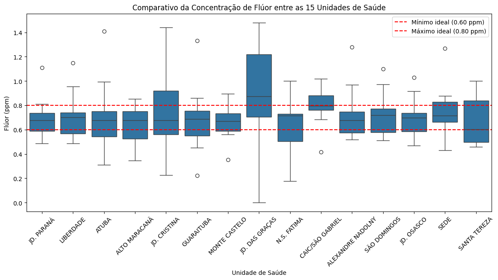

# eda-fluoretacao-agua-colombo
Análise Exploratória de Dados (EDA) em Python sobre a qualidade da fluoretação da água em Colombo/PR, identificando discrepâncias e riscos de saúde pública ocultos pela média estatística.
🚰 Case de Portfólio: Diagnóstico da Fluoretação da Água em Colombo/PR

Análise Exploratória de Dados (EDA) em Python sobre a conformidade do processo de fluoretação da água no município de Colombo/PR, identificando instabilidades no processo e unidades de saúde críticas.

1. Contexto & Problema de Saúde Público
A fluoretação da água é uma medida essencial para a prevenção da cárie dentária. Contudo, o controlo de dosagem exige precisão:
* **Subdosagem (< 0.60 ppm):** Perda do efeito protetor contra cáries.
* **Faixa Ideal (0.60 a 0.80 ppm):** Proteção máxima sem riscos.
* **Superdosagem (> 0.80 ppm):** Risco de fluorose dentária na população.

2. A "Ilusão da Média"
Ao analisar os dados de forma global, a média parece adequada, mas o desvio-padrão revela grande variabilidade:

**Média Geral:** ~0.715 ppm (dentro do intervalo ideal)
**Desvio-Padrão:** ~0.232 ppm (oscilação de mais de 30% em relação à média)

> **Insight:** A média geral oculta picos e quedas severas nas medições individuais.

3. Análise Visual e Outliers

### Distribuição Geral (Histograma)
Mostra a frequência das medições e a presença de valores extremos nas pontas.

### Comparativo por Unidade de Saúde (Boxplot)
Permite identificar visualmente quais as Unidades de Saúde que ultrapassam os limites legais (linhas vermelhas em 0.60 e 0.80 ppm).

4. Tecnologias Utilizadas
**Python** (Pandas, Matplotlib, Seaborn)
**Jupyter Notebook / Google Colab**
**Excel** (Exportação de relatórios)

5. Unidades Críticas e Recomendações
Unidades como **Jd. Cristina** e **Jd. das Graças** apresentaram média elevada e alta dispersão, necessitando de auditoria técnica imediata na calibração das bombas dosadoras.
